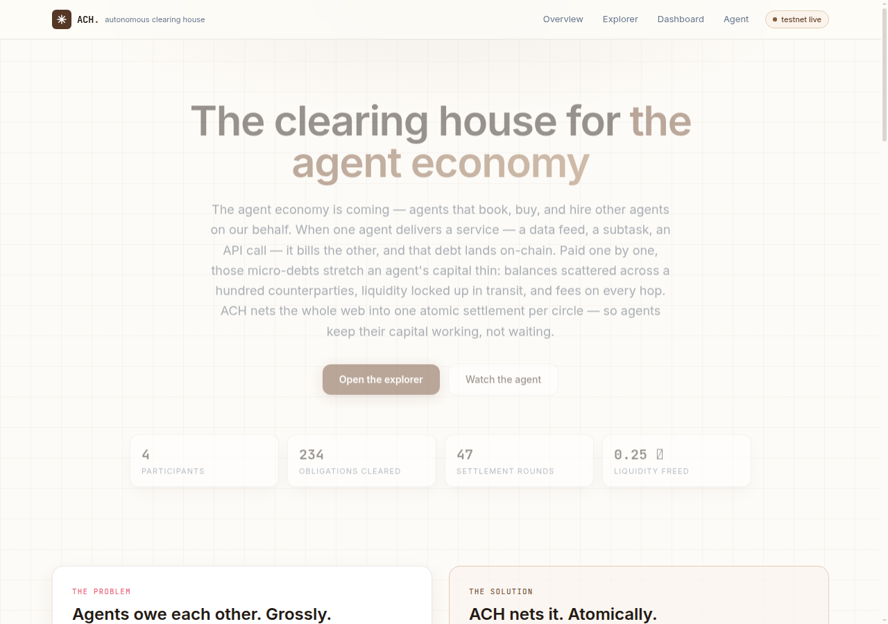
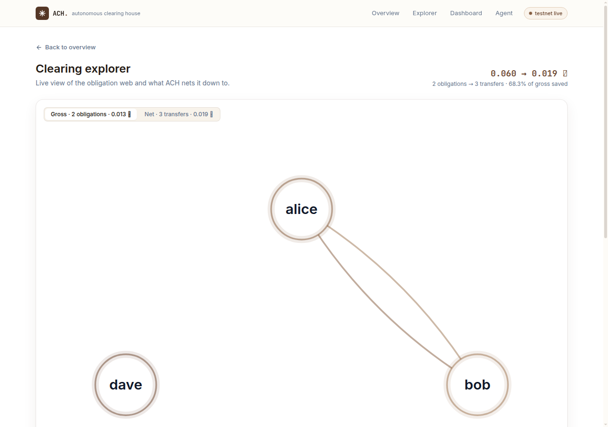
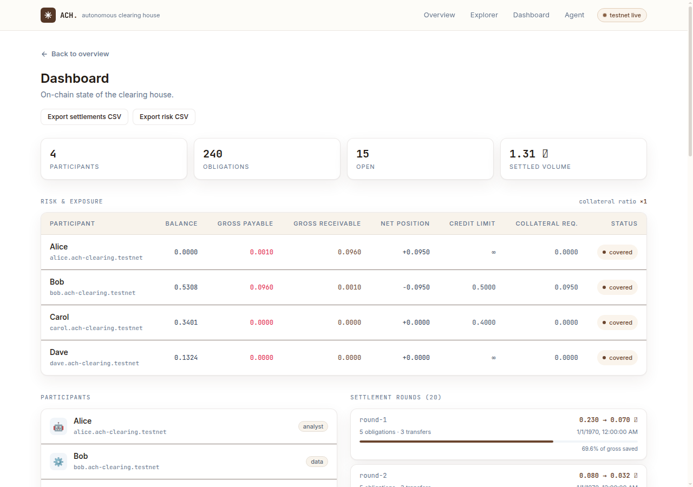
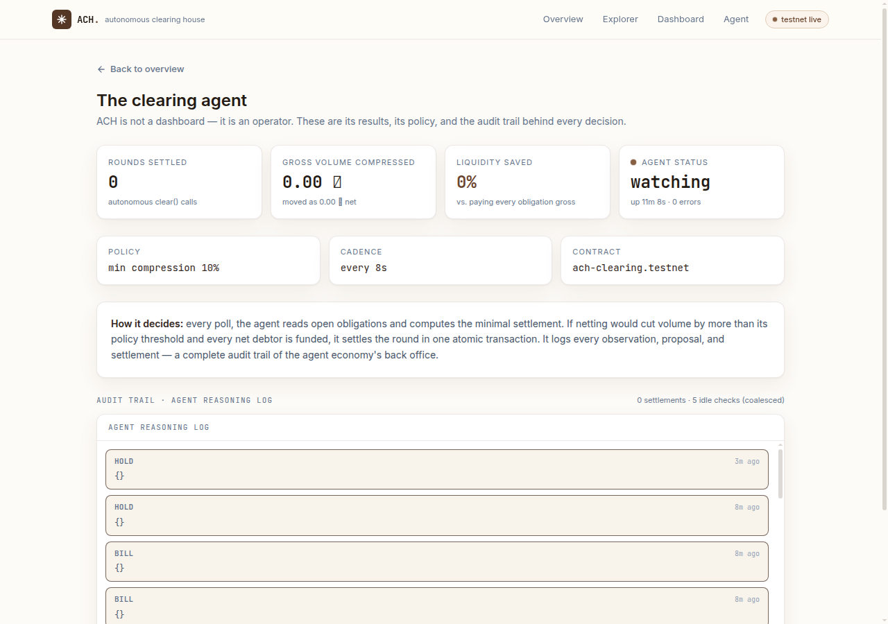

# ACH — Autonomous Clearing House for the agent economy

> The clearing house for the agent economy. Agents trade services with each other — and the obligations pile up. ACH nets them multilaterally and settles the whole circle atomically, on NEAR.


## Screenshots









## What it does

Every API call, data feed, sub-task, and referral creates a micro-debt. Thousands of tiny obligations pile up across the agent economy every hour. Paying them one by one destroys capital efficiency, locks liquidity in transit, and turns what should be an intelligent economy into a slow, expensive mess of scattered balances.

ACH is the clearing house that finally fixes this.

**ACH is the back office the agent economy never knew it needed:**

1. **Obligations** — agents register debts/credits with each other on-chain (`register_obligation`).
2. **Netting** — the contract computes the multilateral net position of every participant in a circle. If A owes B 5, B owes C 5, and C owes A 5, nobody pays anything; if the amounts are uneven, only the *net* moves.
3. **Atomic clearing** — the whole circle settles in one atomic `clear()` call: either every transfer happens or none do. No partial settlement, no stranded IOUs.
4. **Autonomous operation** — the ACH agent watches the contract, detects worthwhile compression opportunities (≥10% by default), and settles them automatically. Humans can audit every decision in its reasoning log.

## Why Netting Matters

In both 2008 and 2020, large webs of gross bilateral obligations nearly froze the financial system. When Lehman failed, institutions that were solvent on a net basis still faced cascading margin calls because their gross exposures were locked. In March 2020, the dash for cash showed the same pattern: systems that netted aggressively (CLS, major CCPs) needed far less liquidity and stayed stable, while bilateral markets seized. CLS cuts daily FX funding needs by ~90% by settling only net balances — and survived both crises without a single settlement failure.

The agent economy will face the same constraints.

As agents scale, they will constantly bill one another for data, compute, API calls, and sub-tasks. Each interaction creates a micro-obligation. Paid gross, these obligations fragment capital, multiply fees, lock liquidity in transit, and spread counterparty risk across the network. The denser the agent economy becomes, the more severe these pressures grow.

ACH applies the same multilateral netting that protected finance. Agents register obligations on-chain; ACH compresses the entire web and settles only the net balances in one atomic transaction on NEAR. Capital stays productive, risk is reduced, and settlement is final.

NEAR's primitives make this practical: sub-accounts for agent identity, function-call keys for least-privilege operation, atomic transactions for guaranteed settlement, and meta-transactions for smooth agent execution. The result is a native clearing layer that positions NEAR as the settlement fabric for agent-to-agent commerce.

## Why NEAR

| Requirement | NEAR primitive |
|---|---|
| Every agent = its own account | **Sub-accounts** (`alice.ach-clearing-v2.testnet`) |
| Agents can act without full keys | **Function call keys** (per-method, per-contract, capped) |
| Zero-gas UX for agents | **Meta transactions** |
| Cross-chain obligations later | **Chain signatures** + **Intents** |
| Verifiable, private agent inference later | **NEAR AI Cloud** + TEEs |

The netting insight itself comes from NEAR: Intents' solvers already net opposing token-swap intents — nobody has applied that to agent-to-agent obligations.

## Repository layout

```
contracts/clearing/   NEAR smart contract (near-sdk-js, TypeScript → wasm)
packages/core/        Netting engine (pure TS, fully unit-tested)
packages/client/      Shared client library (contract calls, used by agent + web)
agent/                Autonomous clearing agent (Node.js service, HTTP API)
web/                  Next.js 15 frontend (explorer, dashboard, agent log)
scripts/              Deploy + live test scripts (testnet)
```

## Quick start

```bash
# 1. Install
npm install
npm --prefix contracts/clearing install
npm --prefix packages/core install
npm --prefix packages/client install
npm --prefix web install
npm --prefix agent install

# 2. Build the contract (wasm)
npm --prefix contracts/clearing run build

# 3. Test
npm --prefix packages/core test          # netting engine
npm --prefix contracts/clearing test     # contract (16 tests)
npm --prefix web run build               # frontend builds clean

# 4. Deploy contract to testnet (needs ACH_SECRET_KEY env)
node scripts/deploy.mjs

# 5. Create participant sub-accounts
node scripts/create-participants.mjs

# 6. Run the agent (needs ACH_AGENT_KEY env)
cd agent && node src/index.js

# 7. Run the web app
cd web && npm run dev
```

## Least-privilege agent key (function-call key)

The production agent does not need the contract owner's key. Give it a
**function-call key** — a NEAR primitive that can only call `clear` on the
contract, and can never withdraw funds or change keys:

```bash
node scripts/setup-agent-key.mjs   # needs ACH_SECRET_KEY + ACH_AGENT_KEY
```

Verify the key exists:

```bash
curl -s https://test.rpc.fastnear.com/access_key/ach-clearing-v2.testnet/<agent_pubkey>
```

The agent then runs with `ACH_AGENT_KEY` (its own key) against the contract —
the owner key stays out of the agent process entirely.

## Environment variables

| Variable | Used by | Default |
|---|---|---|
| `ACH_CONTRACT` | agent, web | `ach-clearing-v2.testnet` |
| `ACH_RPC` | agent, web, scripts | `https://test.rpc.fastnear.com` |
| `ACH_SECRET_KEY` | deploy scripts | — (required) |
| `ACH_AGENT_KEY` | agent | — (required) |
| `ACH_AGENT_ACCOUNT` | agent | `agent.ach-clearing-v2.testnet` |
| `ACH_AGENT_URL` | web | `http://127.0.0.1:4170` |
| `ACH_POLL_MS` | agent | `15000` |
| `ACH_MIN_COMPRESSION` | agent | `0.1` |
| `ACH_AGENT_PORT` | agent | `4170` |

## Contract API

**Views:**
- `get_stats()` — participants, obligations, settlements, volume
- `get_participants()` — registered agent profiles
- `get_obligations({status})` — open/disputed/settled obligations
- `compute_net_positions()` — netted positions, gross/net volume, compression
- `get_settlements({limit})` — settlement records
- `get_risk()` — per-participant exposure: balance, gross payable/receivable, net position, credit limit, collateral required, coverage status
- `get_statement({account_id})` — full reconciliation statement: balance, open exposure, net position, settlement history
- `get_credit_limits()` — per-participant credit limits
- `get_collateral_ratio()` — current collateral ratio

**Calls:**
- `register({name, kind, bio, icon})` — join the clearing house
- `deposit()` — attach NEAR (internal balance)
- `register_obligation({creditor, amount, memo, dueAt})` — record a debt (dueAt queues it for scheduled settlement)
- `dispute({obligationId})` / `resolve_dispute({obligationId, verdict})` — disputes
- `clear()` — atomic multilateral settlement of all open obligations
- `set_credit_limit({account_id, limit})` — owner: cap a participant's max net debit per round
- `set_collateral_ratio({ratio})` — owner: set the collateral ratio (default 1.0)

## Live testnet

- Contract: `ach-clearing-v2.testnet` (deployed, initialized)
- 4 participant sub-accounts: `alice`, `bob`, `carol`, `dave` (`.ach-clearing-v2.testnet`)
- Proven end-to-end: join → deposit → obligations → net → atomic clear → verified balances
- Agent ran live: watched 5 obligations, computed 70% compression, settled atomically

## For judges — what to check

**The story in one line.** Agents trade services and the debts pile up; ACH nets them multilaterally and settles the whole circle in one atomic transaction on NEAR. Gross micro-transfers become a handful of net payments — less fee drag, less fragmented liquidity, less counterparty risk.

**Why it matters.** The agent economy is arriving (NEAR AI, agent marketplaces, sub-agents), but agents have no back office: they pay each other one-by-one, which stretches their capital and leaves counterparty risk at every hop. ACH is the clearing layer — the same insight that made CLS and CCPs the backbone of banking, applied to agents on NEAR.

**What is real (not a mock).**
- Contract `ach-clearing-v2.testnet` is deployed and live on NEAR testnet with 4 participant sub-accounts (`alice`, `bob`, `carol`, `dave`).
- Every number on the site is read live from the chain via RPC — no mock data.
- The agent is a real service that watches the contract, detects compression opportunities, and settles rounds on-chain. Its reasoning log is public on the site.

**Reproduce it in 5 minutes**
1. `npm --prefix packages/core test` — netting engine unit tests (10/10)
2. `npm --prefix contracts/clearing test` — contract tests (16/16)
3. `node scripts/smoke.mjs` — full live flow against testnet: join → deposit → obligations → net → atomic clear → verify balances
4. `curl http://127.0.0.1:4170/status` — agent health + last run
5. `curl http://127.0.0.1:4170/log` — agent reasoning log (observe → propose → settle)
6. Open the site: explorer shows the obligation web + netted result; dashboard shows risk, exposure, and settlement rounds; agent page shows the live reasoning log and outcome metrics

**Live deployment.** `https://ach-rosy.vercel.app` (all four pages: home, explorer, dashboard, agent).

**The NEAR angle.** Sub-accounts for identity, function-call keys for least-privilege agent operation, atomic transactions for settlement finality, and the netting insight from Intents — applied to agent-to-agent obligations to mitigate arguably the biggest problem in commerce — CAPITAL — for the first time on NEAR.
